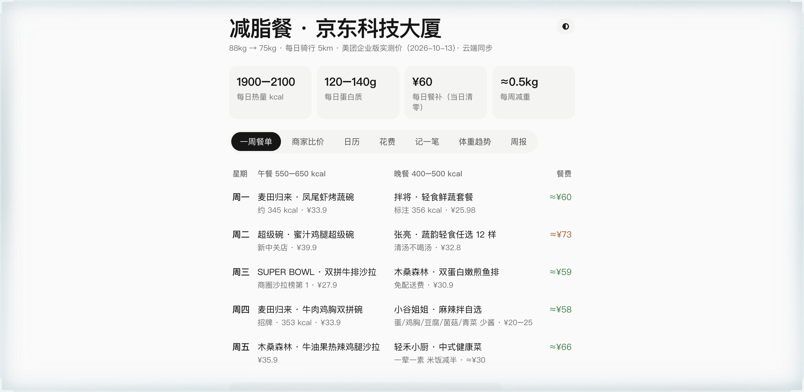

**[中文](README.md) | English**

# Healthy Meals · JD Technology Tower

**[Live Demo](https://zc-ruc.github.io/jianzhi-meals/)**

A mobile-first, single-file meal management app: weekly meal plans, vendor price comparison, expense tracking, weight trends, and weekly reviews, with local storage and optional cloud synchronization.

## Features

- **Weekly meal plan**: lunch and dinner combinations with calories and tested prices, designed around 1,900–2,100 kcal/day, 120–140g protein/day, and an approximate weight-loss pace of 0.5kg/week.
- **Vendor comparison**: ratings, average cost, distance, and representative prices for nearby healthy-food vendors.
- **Calendar and expense entry**: record meal spending by date, with a reminder that the ¥60 daily meal allowance expires at the end of each day.
- **Weight trends**: a weight chart with an 88kg → 75kg target.
- **Weekly reviews**: a weekly summary of spending and weight-loss progress.
- **Cloud synchronization**: merge data across devices through a Cloudflare Worker backend.
- **Dark mode**: follow the system setting or switch manually.

## Usage

This is a single-file application with no build step. Open `index.html` directly. The online version is hosted with GitHub Pages from the root of the `main` branch.

Data is stored in browser localStorage by default. Cloud synchronization requires a compatible Cloudflare Worker endpoint (`jianzhi-sync.*.workers.dev`). The endpoint is privately configured by the author; replace it with your own synchronization service when reusing the project.

## Tech Stack

Vanilla HTML/CSS/JavaScript, with zero runtime dependencies and no build step.
